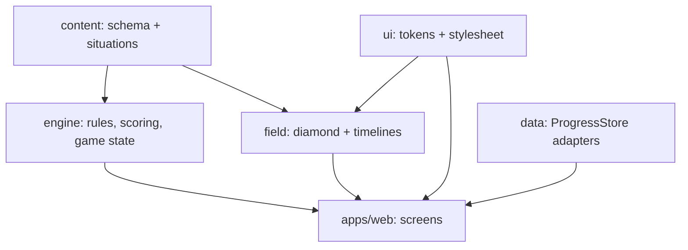

# Architecture

One engine, many modes. Each concern is a package with a typed contract.

## Train mode: one play

The engine defines the phase machine; `apps/web` sequences it and `@st/field` animates it.

| Phase      | Shown                                                                       | Duration (authored, ms) |
| ---------- | --------------------------------------------------------------------------- | ----------------------- |
| `setup`    | Situation-first cue: count, outs, runners (`setupLine`)                     | 2200                    |
| `pitch`    | "Here's the pitch…"                                                         | 900                     |
| `play`     | Pitch → batted ball / steal throw → runners (`buildPlayTimeline`)           | per ball type           |
| `freeze`   | Hold mid-flight (`freeze.mode = in-flight`, at 0.35–0.85) or after the play | 400 / 550               |
| `read`     | Prompt visible, choices veiled, clock stopped                               | 5000 (8U–10U) / 4200    |
| `decide`   | Shuffled choices (`choiceOrder`), clock running                             | 8 s / 6 s               |
| `outcome`  | Chosen choice's `outcome.animation` (timeout → a wrong choice's outcome)    | per path + 420          |
| `feedback` | Title, 0–3 stars, explanation                                               | —                       |

Stars: 3 if ≥ 55% of the clock remains, 2 if ≥ 25%, else 1; 0 for wrong/timeout.
Session score = `round(1000 × (0.5 × accuracy + 0.5 × stars / (plays × 3)))`; levels Bench < 400 ≤
Starter < 600 ≤ Varsity < 800 ≤ All-Star. The formula is never shown in the UI.

## Determinism

All randomness goes through `createRng(seed)` (mulberry32). A session's queue uses
`deriveSeed(seed, 0)`; play _i_'s choice order uses `deriveSeed(seed, i + 1)`. Same seed ⇒ same
session. The web app picks a random seed unless `?seed=` is set.

## Play mode contract (phase 5)

`GameState` (inning, side, outs, count, runners, score, final) and
`applyOutcome(state, outcome) → { state, events }` are implemented and tested. Outs come from runner
marks ending `out` plus `outcome.batterOut`; runs from runners ending `score`. Not built yet: the
inning simulator, offense situations, choosing the next situation from game state.

## Performance and offline

Budget: ≤ 200 KB gzipped JS on first load (`pnpm size`, enforced in CI). Zod is only used by the
validator — the app imports the pre-validated bank via type-only schema imports. The PWA manifest
ships now; the service worker (offline) is a follow-up.
